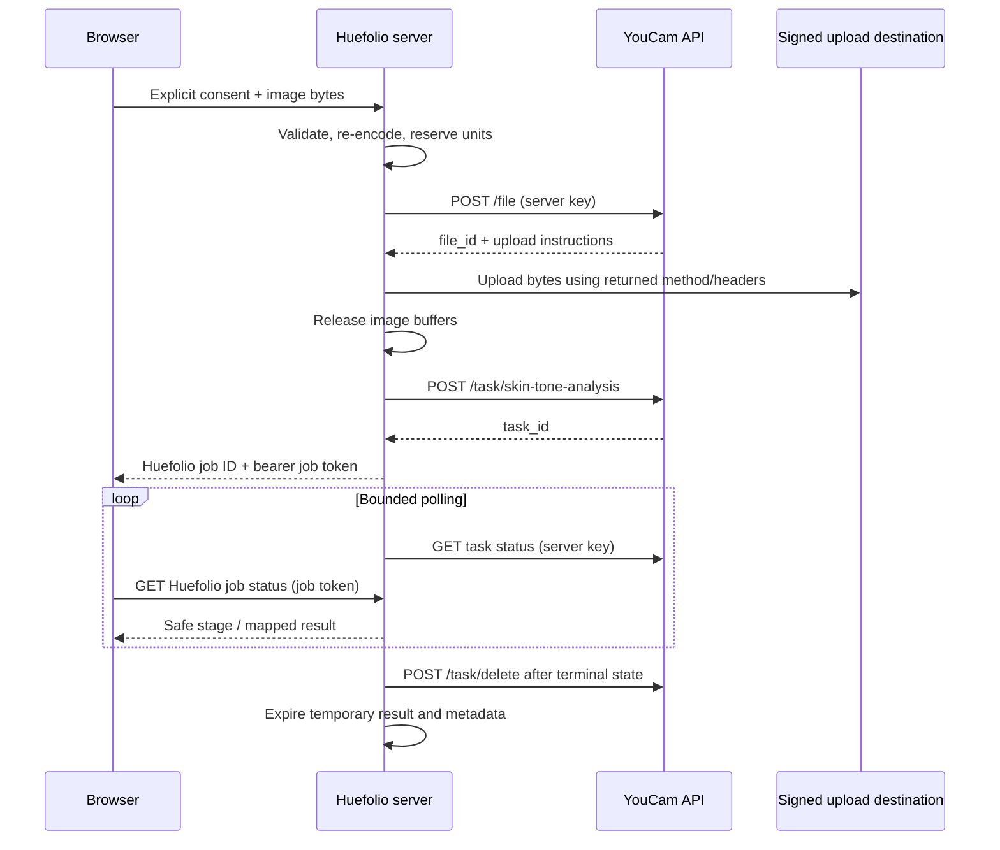

# Huefolio — YouCam integration plan for review

Researched **30 October 2026 (Asia/Karachi)** using public official documentation. Status: **plan only, awaiting approval**. No key was requested/read, no account balance was accessed, no photo was transmitted, and no paid task was created. The approximately 1,000 units are user-reported, not an independently verified balance.

## Recommendation and scope

Select **AI Facial Color Tones Analyzer V1.0**. Its API route contains `skin-tone-analysis`, but this is the facial color endpoint, not the separate Skin Analysis product. Do not request skincare concerns, treatment suggestions, Virtual Try-On, beauty scoring, or inferred medical information.

Defer **AI Face Attributes & Ratio Analyzer V1.0**. Shape and ratio outputs do not improve the approved color workflow; its four color features overlap the main endpoint and omit a documented skin-color output. Age/gender and ideal-proportion comparisons add unnecessary personal inference. No optional second call should run automatically. This is a product-scope decision, not an assertion that the optional endpoint lacks these capabilities. [Color overview](https://docs.perfectcorp.com/reference/ai_skin_tone_analysis), [face overview](https://docs.perfectcorp.com/reference/ai_face_analyzer/section/overview).

## Verified operations

API host: `https://yce-api-01.makeupar.com`. The public product/console URLs are not the API host. The following v2 operations use `Authorization: Bearer <API_KEY>`. JSON requests use `Content-Type: application/json`. Signed file transfer follows its own returned method/headers and must **not** receive the API key. [API server](https://docs.perfectcorp.com/develop/api_server), [authentication guide](https://docs.perfectcorp.com/develop/quick_start_guide).

| Selection | Method and exact path | Parameters / purpose |
| --- | --- | --- |
| Required utility | `POST /s2s/v2.0/file` | `files[]`: required `content_type` string, `file_name` string, `file_size` integer bytes |
| Selected analysis | `POST /s2s/v2.0/task/skin-tone-analysis` | `src_file_id` **or** publicly reachable `src_file_url`; optional `face_angle_strictness_level` |
| Selected polling | `GET /s2s/v2.0/task/skin-tone-analysis/{task_id}` | Required task ID path parameter; asynchronous task |
| Required cleanup | `POST /s2s/v2.0/task/delete` | Required JSON `task_id`; finished task and associated input/output files |
| Optional, deferred | `POST /s2s/v2.0/task/face-attr-analysis` | Same source alternatives and strictness, plus required string array `features` |
| Optional, deferred | `GET /s2s/v2.0/task/face-attr-analysis/{task_id}` | Required task ID; asynchronous task |
| Administrative preflight, later | `GET /s2s/v2.0/credit/feature-cost` | `page_size` 1–20, optional `starting_token`; verify cost before enabling paid work |

Sources: [file contract](https://docs.perfectcorp.com/_bundle/reference/file.json?download=), [color task reference](https://docs.perfectcorp.com/reference/ai_skin_tone_analysis/v1.0), [color contract](https://docs.perfectcorp.com/_bundle/reference/ai_skin_tone_analysis.json?download=), [face contract](https://docs.perfectcorp.com/_bundle/reference/ai_face_analyzer.json?download=), [deletion contract](https://docs.perfectcorp.com/_bundle/reference/task_management.json?download=), [cost contract](https://docs.perfectcorp.com/_bundle/reference/unit_system.json?download=).

Use the file-ID workflow; Huefolio should not create public photo URLs. `face_angle_strictness_level` is `strict | high | medium | low | flexible`, default `high`. Documented angle limits are strict: pitch 4°, yaw 6°, roll 4°; high: 10° each; medium: 15°; low: 20°; flexible: 30°. Start with `high`, do not silently relax it after an error.

Illustrative selected task request (not executed):

```json
{
  "src_file_id": "synthetic-file-id-not-valid",
  "face_angle_strictness_level": "high"
}
```

### Image requirements and validation proposal

Both analyzer overview tables list JPG/JPEG/PNG, one person, long side at most 4096px, and file size **less than 10 MB**. They state that images over 1080px on a side are resized for analysis. The error table names a 320px minimum; face width guidance is greater than 60% of image width. [Color image guidance](https://docs.perfectcorp.com/reference/ai_skin_tone_analysis), [face image guidance](https://docs.perfectcorp.com/reference/ai_face_analyzer/section/overview).

Huefolio policy proposal: reject files at or above **9,500,000 bytes** (conservative below either common MB interpretation), inspect magic bytes and decoded pixels, require both dimensions at least 320px, and reject either dimension above 4096px. These conservative limits are application choices, not new provider parameters. Validate again on the server; browser MIME and extensions alone are untrusted. Limit decoded pixels to 4096² and processing concurrency to prevent memory exhaustion. Decode/orient then re-encode without EXIF/GPS in memory; validate final encoded bytes/size/dimensions before registering the file. Introduce one maintained image-decoding library during the approved implementation; Node's built-in HTTP utilities do not safely decode/re-encode images. No dependency is installed now. Send a generated filename, not the user's original name. The file documentation uses `image/jpg` in its example; confirm acceptance of standard `image/jpeg` during the controlled smoke test rather than assuming the example is a complete MIME enum.

Do not implement face identity or a new face detector just for validation. Explain framing locally; handle provider pose, missing-face, and multiple-person errors with actionable messages. Do not load the optional third-party Camera Kit in the first integration: file upload already satisfies the approved design.

## Exact selected response shape

The included `integration/youcam-contracts.d.ts` models the published wire schemas. Response fields are **optional in the source OpenAPI**, not guaranteed simply because an example includes them. HTTP status and body `status` must both be checked. The backend must require a usable envelope at runtime, then handle missing values explicitly. Unknown properties should be ignored by the mapper, never displayed as new facts.

Submission acknowledgement: `status` integer, `data.task_id` string. Polling: `status` integer; `data.task_status` is `running | success | error`; `data.error` is a nullable documented engine-error string; `data.error_message` is a string; `data.results` contains only the documented color/quality objects below. No percentage, confidence, season, undertone, or personal recommendation field is documented. Unlike generic image-effect prose, this selected response schema does **not** define a result-image URL or `dst_id`.

Synthetic success example (field names from the contract; all values invented for offline review):

```json
{
  "status": 200,
  "data": {
    "task_status": "success",
    "results": {
      "face_quality": {
        "has_face": true,
        "area": "good",
        "frontal": "good",
        "lighting": "good",
        "faceangle": "good"
      },
      "color": {
        "eye_color": "#513C2D",
        "eye_color_name": "Brown",
        "lip_color": "#AC7275",
        "eyebrow_color": "#42342A",
        "skin_color": "#BA9279",
        "hair_color": "#42280E",
        "hair_color_name": "Brown"
      }
    }
  }
}
```

Source: [published color schema](https://docs.perfectcorp.com/_bundle/reference/ai_skin_tone_analysis.json?download=). Fixtures also cover running, sparse success, engine error, insufficient credit, upload instructions, and deletion. A sparse success is permitted by the schema but is **not evidence that the live service returns that case**. No fixture is loaded by the frontend or copied into `dist/`.

### Output-to-feature mapping

All paths below begin at `data.results`.

| Documented path | Type | Huefolio use |
| --- | --- | --- |
| `color.skin_color` | Six-digit HEX pattern | Measured skin swatch in results; source input for app suggestions; optional card detail |
| `color.eye_color` | HEX-described string | Measured eye swatch; pairing reference; optional export |
| `color.eye_color_name` | Amber, Brown, Green, Blue, Gray, Other | API-provided eye color label; never derive a personality/ethnicity label |
| `color.lip_color` | HEX-described string | Measured lip swatch for color exploration; no makeup product prescription |
| `color.eyebrow_color` | HEX-described string | Measured eyebrow swatch and optional card detail |
| `color.hair_color` | Literal HEX enum in OpenAPI | API hair category swatch; do not imply continuous hair-color precision |
| `color.hair_color_name` | Auburn, Black, Blonde, Brown, Grey/White, Red | Label returned by provider; preserve alongside the returned value |
| `face_quality.has_face` | Boolean | Input-quality handling; not identity recognition |
| `face_quality.area` | String, example `good` | Optional photo-quality hint |
| `face_quality.frontal` | String, example `good` | Optional framing hint |
| `face_quality.lighting` | String, example `good` | Optional lighting hint |
| `face_quality.faceangle` | String, example `good` | Optional pose hint |

The quality strings have **no exhaustive enum** in the schema; do not invent numeric scores or claim every possible string is known. The documented hair-value enum is `#a0a0a0`, `#722626`, `#000000`, `#FAF0BE`, `#42280E`, `#808080`, `#B56637`. The documentation's example pairs gray-looking `#a0a0a0` with `Auburn`; do not reverse-engineer a universal HEX-to-name mapping from that example. Retain provenance and flag invalid values rather than guessing corrections.

### Calculations owned by Huefolio

- Normalize and validate five measured color codes for display; preserve raw source values only in temporary server processing.
- Build a separate suggested wardrobe/accessory/makeup **color** palette using a documented, versioned transformation of available measured colors. Measured facial colors are not automatically flattering clothing colors. Algorithm approval and usability evaluation are still required.
- Calculate HSL complementary hues, saturation/lightness variations, creative occasion arrangements, and optional perceptual color distances. The current RGB-distance demo must remain accurately labeled until a replacement is chosen.
- HEX copying, user-selected card colors, PNG/text exports, and any human-friendly names for app-generated swatches are application features.
- Do not assign seasonal or undertone labels in the first integration. They are not selected endpoint outputs; no inferred labels should be attributed to YouCam.

## Optional face endpoint audit

Required `features` is an array of exact enum identifiers; full declarations are included for offline review. The response envelope is the same task-status pattern, with `results.face_quality`, `facialratio`, `cheekbone`, `eyelid`, `eyebrow`, `faceshape`, `lipshape`, `nose`, `color`, and `agegender`. Outputs depend on requested features; none is assumed always present. [Official face contract](https://docs.perfectcorp.com/_bundle/reference/ai_face_analyzer.json?download=).

| Requested feature family | Output paths under `results` | Decision |
| --- | --- | --- |
| `faceShape` | `faceshape` | Defer; no color-generation benefit |
| `eyeShape`, `eyeSize`, `eyeAngle`, `eyeDistance`, `eyelid` | `eyelid.left_shape/right_shape`, `size`, `left_angle/right_angle`, `setting`, `left_eyelid/right_eyelid` | Do not request for current scope |
| `eyebrowShape`, `eyebrowThickness`, `eyebrowDistance`, `eyebrowShortness` | `eyebrow` shape/thickness/gap/shortness fields; schema also lists tail thickness and thinness | Do not request; extra fields are not a reason to infer an unlisted feature parameter |
| `lipShape`, `noseWidth`, `noseLength`, `cheekbones` | `lipshape[]`, `nose.width/length`, `cheekbone.left/right/overall` | Do not request |
| `eyeColor`, `lipColor`, `eyebrowColor`, `hairColor` | `color` with four HEX colors and eye/hair names; no documented `skin_color` here | Overlaps primary analysis; no second paid call |
| `age`, `gender` | `agegender.age/gender` | Do not request or display |
| Eleven ratio feature identifiers | Numeric arrays in `facialratio`; exact keys in the declarations | Exclude; no ideal-proportion or attractiveness assessment |

The optional schema includes `eyebrowPosition` as a request enum but no clear corresponding ratio output property. Its enum contains 31 feature identifiers while the pricing table ends at 28 features. Do not submit all features or extrapolate an undocumented pricing tier. If a later approved feature needs this endpoint, first confirm its feature-to-output mapping and pricing with the provider. No optional endpoint is selected by this plan.

## Units and budget

| Per successful analysis | Units | Maximum successes from exactly 1,000 units |
| --- | ---: | ---: |
| Color only — recommended | 20 | 50 |
| Color + optional face task with 1–5 features | 30 | 33 |
| Color + optional face task with 6–14 features | 40 | 25 |
| Color + optional face task with 15–28 features | 50 | 20 |

Prices: [color unit table](https://docs.perfectcorp.com/reference/ai_skin_tone_analysis/section/overview/unit-consumption), [face unit table](https://docs.perfectcorp.com/reference/ai_face_analyzer/section/overview/unit-consumption). The arithmetic assumes independent successful tasks at published prices; it is not an account-specific quote. The overview says engine failures consume no units and successful tasks do; a timeout/disconnect after submission does not prove failure and may still be charged. No separate unit tariff for file registration, transfer, polling, or task deletion is listed in the reviewed materials; do not present that omission as a separately verified free-service guarantee.

Proposed allocation: 100 units for up to five controlled integration successes; 800 for up to 40 user/demo successes; 100 reserve. Prefer synthetic offline fixtures for all repeatable tests. The hard 800-unit application budget in `.env.example` is a proposed release cap, not a spend authorization or account balance. Reconfirm actual grant restrictions, balance/expiry and SKU cost in the console before live tests. `GET /s2s/v2.0/credit/feature-cost` returns `status`, `result.next_token`, and `result.skus[]` with `description`, `amount`, `unit`, `proc_unit`, `run_task_url`; paginate and identify the exact selected SKU. Do not expose this admin response to visitors.

Budget control must reserve 20 units atomically **before** each task POST, release only on a proven uncharged failure, and retain a reservation on ambiguous delivery. Never auto-repeat a task POST after a network timeout: there is no documented provider idempotency parameter. Local job idempotency prevents double-clicks, not unknown provider-side duplication. Keep at most two paid jobs active. With no database, reservations are instance-local: after process restart, fail closed until an operator reconciles provider usage. Multi-instance hosting requires a shared atomic spend guard or provider-side account cap, so it is not part of the first in-memory deployment.

## Backend design — proposed, not implemented

Keep the existing buildless frontend. Add a **same-origin Node backend** alongside static serving after approval; no frontend framework migration. A single long-running Node instance can maintain bounded job metadata in memory and poll upstream without relying on a browser tab remaining open. Select a host that permits the required upload size, background work and job duration; a short-lived serverless function is not an equivalent deployment without a worker strategy.



Proposed **Huefolio-owned** routes (these are not YouCam fields): `POST /api/analyses`, `GET /api/analyses/:id`, `DELETE /api/analyses/:id`. Accept a bounded image body and explicit versioned consent field/header; reject missing consent before any provider operation. A client-generated request ID plus an in-memory nonce mapping makes double-submit handling idempotent locally. Return a cryptographically random opaque job ID and separate unguessable job token; keep token only in browser memory and send in a request header, never URL/query/localStorage. Validate token ownership on every status/cancel request. No account/login required.

1. Enforce Origin/Host, same-origin CORS, request content type, body byte limit while streaming, total request timeout, per-session/IP rate limits, and global capacity before buffering. Reject browser-supplied provider URLs, file/task IDs, endpoint names, feature lists, or strictness overrides. Fixed allowlisted task configuration only.
2. Decode and strip metadata in memory; never write uploads to disk, temp files, database, object storage, or logs. Bound buffers and release references in `finally` paths. JavaScript garbage collection is not a cryptographic secure-erasure guarantee.
3. Register the final image, then complete its signed upload before starting analysis. Inspect registration status, top-level `files`, required operational fields and matching MIME/size before proceeding. For the initial single-image flow require one expected file and supported transfer instructions. Do not guess a multipart/chunking workflow; reject and investigate unexpected instructions. Upload status must be successful.
4. Treat upload instructions as untrusted upstream data: HTTPS only, exact provider-approved storage hosts configured server-side, DNS/IP checks against private/link-local/loopback destinations, no redirects, narrow allowed methods/headers. No broad `*.amazonaws.com` trust rule. The reviewed docs do not provide the actual signed-upload hostname allowlist; confirm it during the approved smoke test before enabling general uploads. Never forward `Authorization`, cookies, or server credentials to the signed destination.
5. Submit one color task using `src_file_id`. Require a nonempty `data.task_id`; associate it only with the private local job. Do not return provider upload URLs/IDs or API key. Images and original filename are absent from all operational logs and browser status payloads.
6. Poll in one server-owned loop per task, initially every five seconds with jitter. Use a global rolling-window limiter at **200 API requests per 300 seconds** to leave headroom; no overlapping polls. The provider publishes 250/300s for both IP and token. Its separate suggestion of 5 QPS is inconsistent with that sustained quota; follow the stricter rolling-window limit, not 5 QPS indefinitely. Honor `Retry-After` when present and bounded exponential backoff for transient GET failures. [Rate limits](https://docs.perfectcorp.com/develop/rate_limit).
7. Proposed limits: 120-second interactive wait, 10-minute cleanup/polling maximum, 15-minute absolute result TTL with no extension from reads, max two active analyses and bounded retained-result count. These are Huefolio policies, not documented task durations. Show a waiting/timeout state at the interactive limit; do not automatically create a new paid task. Continue cleanup polling within the bounded background window after local cancellation. At terminal status validate/map results before requesting deletion. On expiry discard facial-color results, retain only minimal task metadata for the remaining cleanup window, then release it. No database or permanent task history.
8. DELETE on a Huefolio job hides/drops the local result and schedules best-effort provider cleanup; it is **not a provider cancellation API**. A running task can still finish and consume units. After success/error, call documented task deletion, retry bounded transient cleanup failures, record only a scrubbed cleanup outcome, and discard IDs. A confirmed successful delete removes the task's associated files according to its contract. Never tell the user cleanup succeeded when the call failed.

## Privacy and credential controls

`YOUCAM_API_KEY` belongs only in server environment/secret configuration. `.env.example` contains placeholders; `.env` and `.env.*` are ignored. No `VITE_`, `NEXT_PUBLIC_`, browser config, HTML, source map, URL query, client header, or export may contain the key. Do not echo it in startup messages. Backend startup should fail closed when integration is enabled without a configured key. Keep integration disabled by default.

No uploaded bytes, data URLs, base64, EXIF, original filenames, raw provider bodies, signed URLs, API keys, job tokens, or face characteristics in access/error/APM traces. Log coarse stages, HTTP class, sanitized error category and aggregate latency only. Disable request/response body capture on the reverse proxy and host; configure its buffering to avoid photo files on disk. Audit deployment defaults rather than assuming application code alone prevents disk persistence. Set analysis responses `Cache-Control: no-store`; change CSP from `connect-src 'none'` to `connect-src 'self'` only when routes are connected. No direct browser-to-YouCam calls, no third-party analytics or persistent browser storage.

### Retention limitation that must be visible before upload

The current [retention page](https://docs.perfectcorp.com/develop/file_retention_period) says files and task IDs last 30 days; download URLs last two hours. The [delete operation](https://docs.perfectcorp.com/_bundle/reference/task_management.json?download=) removes finished tasks and associated files, but returns `OperationInvalid` for unfinished tasks. The reviewed file API has no standalone file-delete operation. Thus an upload followed by a failed/ambiguous task creation may leave a provider-side orphan that Huefolio cannot immediately remove through the documented API. Process crashes and failed cleanup also fall back to provider retention. No promise of deletion on refresh/close can extend to that provider behavior.

Proposed copy for connected mode: “Huefolio uses temporary memory and does not save your photo to a profile. With your consent, we send it to YouCam for analysis. YouCam documents retention of uploaded files for 30 days. We request earlier deletion after processing where supported; failures may leave files until provider expiry. Refreshing or closing clears your local session.” Link the actual retention and provider privacy terms beside consent. Exact final copy needs review before enabling transmission; if this retention is unacceptable, do not upload and request an alternative retention arrangement from the provider.

## Frontend changes required after plan approval

| Existing file | Planned change |
| --- | --- |
| `src/app.js` | Add real job state, consented same-origin upload, one status loop, AbortController, reset/cancel handling, expiring job token; retain independent sample mode |
| `src/model.js` | Separate measured YouCam colors from versioned Huefolio suggestions; align conservative size/pixel validation; support partial/missing fields |
| `src/pages.js` | Replace availability page with real event-driven stages; render measured HEX/names and useful quality hints; update third-party retention/consent copy |
| `src/components.js` | Preserve source labels; accessible status/error notifications, retry and replace-photo actions |
| `src/export.js` | Include only selected real color values and optional available API characteristics; mark app-generated suggestions; keep photo excluded |
| `scripts/serve.mjs` / new backend modules | Add private API routes and server-only environment validation, job owner checks, bounded upload/poll/cleanup, `connect-src 'self'` |

Stages come from real events: receiving photo → uploading to provider → awaiting analysis → deriving palette → complete/error. No percentage unless a future verified source supplies one. Browser status polling should not cause a new upstream poll per request. Replacing a photo invalidates consent and any old local result; stale responses must not repopulate a reset session. On refresh/back-cache restore, discard token/results and show a fresh-session state. In-tab route changes may retain session memory. Keep all synthetic fixtures opt-in/offline and never merge them with a real profile.

## Error handling and retry policy

| Failure | Safe behavior |
| --- | --- |
| Local MIME/magic/size/pixel/decode failure | Reject before provider upload; readable correction; no credit reservation spent |
| InvalidParameters / BadRequest | Stop; sanitize visitor message; fix contract/config, do not auto-repeat |
| HTTP 401 | Disable connected analysis; operator fixes key; no credential details in UI |
| CreditInsufficiency | Explain temporary unavailability; no repeat; release reservation only on definitive rejection |
| HTTP 429 | Respect global limit; bounded retry for reads; no blind paid POST retry |
| HTTP 5xx/network loss after task POST | Mark submission uncertain, retain reservation, never auto-resubmit; reconcile usage |
| `task_status=error` inside HTTP 200 | Treat as failure, not success; provider error message never rendered raw |
| `error_no_face`, pose/framing/angle errors, multiple people | Explain how to retake/choose a single-person photo; retry only by explicit action with renewed consent |
| Invalid/missing result colors | Do not fill with samples; partial result only if usable fields remain; otherwise no usable data |
| TaskTimeout / InvalidTaskId | End interactive polling; no automatic new task; distinguish local timeout from proven uncharged failure |
| Cleanup OperationInvalid | Task still running; bounded polling then retry delete after terminal status |
| Cleanup OperationNotSupport / InvalidTaskId / transient failures | Investigate/retry only where meaningful; do not guarantee provider deletion; disclose retention fallback |
| Unknown HTTP/engine codes or changed schema | Fail safely with generic message, scrubbed diagnostics and no guessed fields |

Provider sources: [general error guide](https://docs.perfectcorp.com/develop/error_codes), [color HTTP/engine schemas](https://docs.perfectcorp.com/_bundle/reference/ai_skin_tone_analysis.json?download=), [cleanup errors](https://docs.perfectcorp.com/_bundle/reference/task_management.json?download=). The prose face-position errors are broader than the OpenAPI engine enum; the future runtime adapter must safely handle unknown error strings without claiming an exhaustive list. Request failures use top-level `error/error_code`; engine failures use `data.error/error_message`.

## Documentation discrepancies and approval checklist

1. **Retention:** newer retention page says 30 days; task response schema describes 24-hour task validity. Use immediate polling and short local TTL, and confirm actual production behavior before promising access windows.
2. **File response:** schema has an invalid `data: null` property next to a `$ref`; the rendered example uses top-level `files`. Types flag this. Capture one approved controlled response to confirm exact wire shape; do not invent `data.files`.
3. **Generic prose:** references to generated images/`dst_id` do not appear in the selected status schema; no image download/chaining feature is planned.
4. **Quota:** 250/300s conflicts with suggested sustained 5 QPS. Apply stricter rolling-window limits.
5. **Optional face schema:** 31 request enums versus cost tiers through 28; `eyebrowPosition` has no explicit output mapping. Defer the endpoint rather than guess.
6. **Eligibility/pricing:** public documentation verifies published unit amounts, not this account's endpoint access, hackathon restrictions, grants, expiry, or signed storage hosts. Recheck those server-side/console during the approved preflight.

Review decisions requested: select color-only; accept the provider retention disclosure and best-effort cleanup limits; approve the 100/800/100 allocation and no automatic paid retries; approve the conservative image limits, single-instance backend, and deferred shape/ratio analysis. Only after approval should implementation and controlled smoke tests begin. Retest private job authorization, double-submit races, network ambiguity, file validation, unknown/partial data, cleanup, rate/budget exhaustion, session reset and credential leakage using fixtures before any live task.

## Files prepared, without enabling integration

- `integration/youcam-contracts.d.ts`: documentation-derived types, including the optional endpoint audit.
- `integration/fixtures/`: ten synthetic wire examples plus provenance notes.
- `.env.example` and ignore rules: server-only placeholder configuration, integration disabled.
- This plan: endpoint, mapping, privacy, security, budget, error and implementation decisions.

Application source, runtime dependencies, CSP, frontend behavior, and API connectivity are unchanged by this planning delivery.

Validation: all 11 tests and the static build passed. Tests check fixture provenance/field structure, separate request versus engine failures, non-live upload destinations, and fixture/key isolation from frontend modules. Contract declarations passed Node's TypeScript syntax parser; this is not a full TypeScript type check, runtime schema validator, or verification against a live provider response. Live protocol uncertainties remain explicitly listed above.
